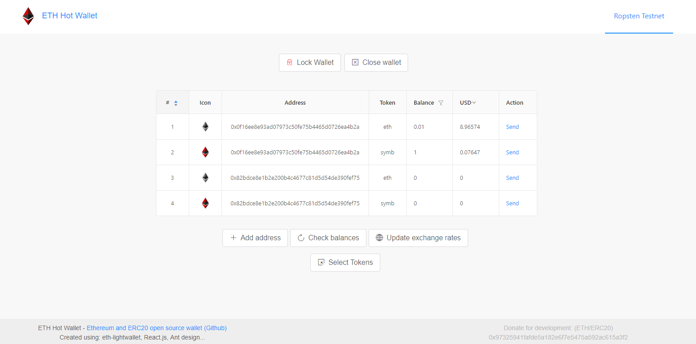
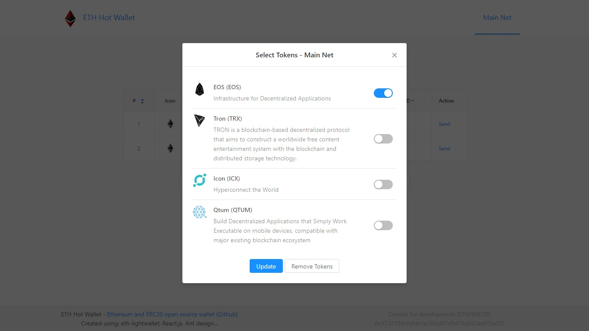

# ETH Hot Wallet

An embeddable Ethereum web wallet with ERC-20 support. Keys are generated, stored and used for signing inside the page, so it needs no external signer such as MetaMask.



Background: [How to build an Ethereum Wallet web app](https://medium.freecodecamp.org/how-to-build-an-ethereum-wallet-web-app-ac77dcaac573) (Medium).

## Features

- BIP-39 seed and HD addresses on the standard path (`m/44'/60'/0'/0/n`), so the seed also works in other wallets
- The seed is stored in the browser, encrypted with your password (PBKDF2 + AES-GCM)
- Transactions are signed in the page; no wallet extension needed
- ETH and ERC-20 tokens look and work the same
- EIP-1559 fees and gas limits are estimated automatically
- Locks itself 15 minutes after unlocking
- Content Security Policy: the page runs only its own scripts and connects only to its RPC nodes and CoinGecko
- Network selector: Main Net, Sepolia, local node or offline
- Balances converted to USD, EUR and BTC
- Responsive layout for mobile

## Networks and APIs

- [PublicNode](https://ethereum-rpc.publicnode.com) keyless JSON-RPC endpoints for Main Net and Sepolia by default
- [CoinGecko](https://www.coingecko.com/) for exchange rates

To use your own RPC provider (e.g. Infura or Alchemy), set it when starting or building:

```bash
MAINNET_RPC_URL=https://mainnet.infura.io/v3/<project-id> SEPOLIA_RPC_URL=https://sepolia.infura.io/v3/<project-id> npm start
```

The wallet checks that each endpoint serves the expected chain ID and signs transactions with it (EIP-155).

## Development

Requires Node.js 20.19+ or 22.12+.

| Command | |
| --- | --- |
| `npm start` | Dev server with live reload at http://localhost:3001 |
| `npm run build` | Production bundle in `build/` |
| `npm run preview` | Serve the production bundle locally |
| `npm test` | Run the tests (Vitest) |
| `npm run lint` | Lint (ESLint) |

Built with [viem](https://viem.sh) (keys, signing, JSON-RPC), [react-boilerplate](https://github.com/react-boilerplate/react-boilerplate) (React, Redux, Redux-Saga, Reselect), [Ant Design](https://github.com/ant-design/ant-design) and [Vite](https://vite.dev).

### Code layout

- `app/utils/wallet.js`: seed encryption and key derivation
- `app/containers/HomePage`: wallet actions (create, restore, unlock, add address, save and load)
- `app/containers/Header`: all network communication (RPC, balances, sending, exchange rates) in `saga.js`
- `app/containers/SendToken`: state of the send dialog; checks and sending happen in Header
- `app/containers/TokenChooser`: pick ERC-20 tokens from per-network lists in `token-lists.js`



## Roadmap

- [ ] Event log
- [ ] CI
- [ ] External security audit

## License

MIT, see `LICENSE.md`.
